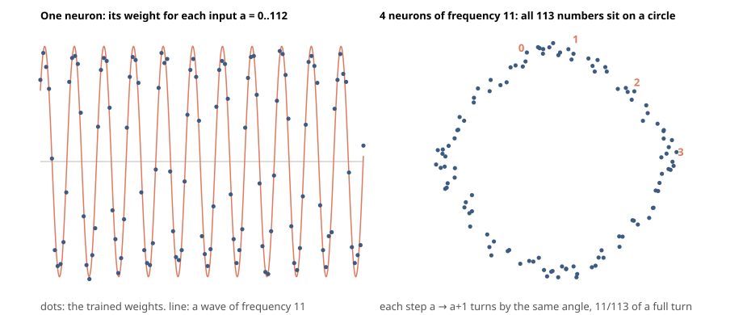

# A trained network, checked by Lean

For the published raw transformer evidence, use the single command block in [VERIFY.md](VERIFY.md). The r2 bundle includes its inventoried verifier and pinned lean-toolchain. Kernel replay checks the shipped theorem term and 20 new modules against the printed proposition; it assumes authenticated earlier project and upstream objects and does not establish that every object was built from bundled src/. A bounded `--from-source` probe compiled one module successfully but produced different object bytes; whole-bundle source reproduction is unestablished. Establishing the full source relationship requires rebuilding and comparing every module with pinned dependencies.

[](https://github.com/teal-sea/lean-checked-network/actions/workflows/check.yml)


A one-layer, four-head transformer adds modulo 113 correctly on all 12,769 input
pairs. The model uses quantised integer weights at `S = 256` and exact real softmax.

**In short**

- **Every answer is proved.** The correct class has a strictly larger logit than every
  other class, and first argmax returns it. The theorem
  `TransformerBridge.FinalRaw.raw_model_adds_mod_113` has no hypotheses; its axioms
  are `propext`, `Classical.choice`, and `Quot.sound`.
- **Checked twice, with stated scope.** Lean checked the proof; the default reader
  replays the 20 new modules with `leanchecker`. Independently implemented
  `nanoda_bin` 0.4.19 checked 82,927 declarations from the exact released objects,
  with the axiom allowlist enforced and no type-checking errors. It also reported
  one axiom pretty-printer error. Default `verify.sh` does not invoke nanoda.
- **Tested wrong data is rejected.** All 9 certificate/table-identity controls were
  rejected with passing unchanged twins (`verify.sh --controls`). Separate release-note
  tampering trials against the verifier are historical; the default reader command does
  not run them. These tests are not an exhaustive security proof or a claim that every
  changed weight makes the network incorrect.
- **The limits are small and explicit.** This is a tiny model on a toy task, proved
  by brute force over all inputs. It is the integer-rounded model, not the float
  checkpoint.

Read the [status](transformer/STATUS.md), the [Kronecker method note](transformer/mathlib/KRONECKER.md),
and the [r2 evidence release](https://github.com/teal-sea/lean-checked-network/releases/tag/transformer-final-raw-evidence-r2).

## How this was built

AI coding agents (Claude Code and Codex workers) wrote the proofs, generators and
checks under Thomas Lince's direction. Scholar-style review agents challenged the
statements, trust boundary and reported claims. This was agent review, not outside
review. Lean's kernel and `leanchecker` checked proof terms; nanoda independently
checked the documented theorem closures. Thomas checked the frozen statements, limits and releases by hand, rather than
writing the proof terms. See the
[audit](AUDIT.md), [transformer status](transformer/STATUS.md) and
[ACAS status](acas/STATUS.md) for checking scope and limitations.

## ACAS Xu certificate checking

Lean checks an alpha-beta-CROWN certificate for the frozen exact-real ACAS Xu network 1_1, property 1, using TorchLean semantics; see the [ACAS evidence and limits](acas/README.md).

## Earlier MLP result

A small neural network learned to add on a clock with 113 hours: given two numbers `a` and
`b` from 0 to 112, it answers `(a + b) mod 113`. It was trained on half of the 12,769 possible
pairs. This repository proves, with Lean's kernel, that it is right on every pair, and shows how
it works: each neuron turns numbers into points on a circle, and the answer comes from adding
angles.

**In short**

- **It is right everywhere.** Lean proves the trained network answers `(a + b) mod 113` for all
  12,769 pairs, including the 6,385 it never saw in training. A second, independent proof
  checker confirms it.
- **The circles are the mechanism.** Cut every neuron down to its single circle wave and Lean
  proves the network is still right everywhere. Remove the circle waves instead and it gets 50
  of 12,769 right.
- **The explanation proves every answer.** An exact calculation built only from the circle
  explanation and explicit error bounds proves all 12,769 answers (in Python, not yet in Lean).
- **The explanation is also a theorem for every clock, 2026-10-16.** Fix the phases of Gromov's analytic
  weights and the unwanted waves cancel exactly: a Lean proof on Mathlib that such a network adds mod p for
  every modulus p >= 3; choosing scale M=25 gives weights in [-25,25], representable with 6 signed bits
  (5 magnitude bits plus sign). Separately, brute-force kernel checks cover **12-neuron 8-bit** nets at
  113 and at 257; those run at M=127, below the Mathlib cycle theorem's sufficient scales, so they are
  not instances of that theorem (`phasegrid/`).
- **Training runs become theorems too, 2026-10-16.** A runner kernel-checks any configuration and states
  exactly where a network is wrong; a recurrent adder is proved for inputs of every length; and the six
  checkpoints of this repository's 64-neuron run carry their exact scores as theorems (`sweep/`, `rnn/`).



*Left: one neuron's weight for each input is close to a wave. Right: four neurons that share a
frequency place the 113 numbers near a circle; moving from a to a+1 turns by 11/113 of a full
turn on average (individual steps vary between about 0.6 and 1.4 times that). Both panels are the
trained weights, not a model of them.*

## Results

Each line says how it was established. **Kernel-checked** means Lean 4's kernel accepted the
proof, using only Lean's standard axioms (`propext`, `Classical.choice`, `Quot.sound`) and no
`sorry`. **Measured** means a Python computation. **Derived** means an argument in exact
integer arithmetic, cross-checked against the real network, but not written in Lean.

| Claim | How established |
| --- | --- |
| The trained network answers `(a + b) mod 113` for all 12,769 pairs | kernel-checked: `LeanCheckedNetwork.Trained.adds_mod_113` |
| Keep only one circle wave per neuron (each weight table keeps its own amplitude and phase at the neuron's frequency), rounded to whole numbers, drop everything else: still right on all 12,769 pairs; minimum margin 1,980,696 measured separately | correctness kernel-checked: `LeanCheckedNetwork.CircleOnly.adds_mod_113` |
| Both theorems re-checked by independent checkers: `lean_run.log` (2026-10-15) records `leanchecker` on 40 of 40 Trained+CircleOnly modules; today's `run_lean.sh` also rebuilds FixedPhase12/16 and Mod12All (85 modules) and is what CI runs; nanoda 0.4.17 checked the three main MLP theorems (2,569 declarations). Separate later nanoda runs: transformer 0.4.19 / 82,927; ACAS 59,489 — each reported one axiom pretty-printer error | kernel-checked twice (see `AUDIT.md`) |
| Swapping the read-out rows of answers 0 and 1 (226 pairs then wrong) makes the same proof fail | kernel rejection: `lean/expected_fail/FaultRow.lean` |
| The circle explanation, with every error bounded exactly, proves the right answer for all 12,769 pairs (tightest pair keeps 1.7% of the margin) | derived (`mechanism.py`, `MECHANISM.md`) |
| No single W2 weight change within [-128, 127] can flip any answer of the trained network: the smallest winning margin (32,654,491) is about twice the most one such change can shift the gap between two scores (at most 254 × 255² = 16,516,350). For an E1/E2 edit the same product bound is not tight enough by itself; measured searches still left margins near 19 to 20 million | derived (W2); measured (E tables) |
| Remove the circle waves, keep the rest: right on 50 of 12,769 pairs, fewer than the 113 that answering the same number every time would get | measured |
| Networks written from the circle formula with fixed phases, no training, right on every pair: 12 neurons at modulus 113 with 8-bit weights (frequencies 39 and 45, selected by a measured search over 1,540 two-frequency sets; the explicit network's correctness is kernel-checked), 16 neurons on the same frequencies, 40 neurons on every frequency at modulus 12, and 12 neurons at modulus 257 (66,049 pairs); the theorem for the same construction (it does not reach these networks at their scale) and its three larger instances are in `phasegrid/` | kernel-checked: `LeanCheckedNetwork.FixedPhase12.adds_mod_113`, `FixedPhase16`, `Mod12All.adds_mod_12`, `Mod257Min.adds_mod_257` (2026-10-16, standard axioms, replayed by `leanchecker`); `phasegrid/smallest-networks.md` |
| A learning curve whose every point is a theorem: the six checkpoints of this repository's 64-neuron training run (`runs/p113_h64.log`, reproduced exactly by `train.py`) are wrong on exactly 3, 2, 3, 2, 2 and 0 pairs, each pair named; every wrong pair is a held-out pair; at every checkpoint the circle-only reduction (rescaled into the fast evaluator's range) is wrong on hundreds of pairs, even at step 12,000 where the network is right everywhere. The Lean packages themselves were built in scratch and are not committed; `result.json` per checkpoint is in `sweep/tests/learning-curve/` | kernel-checked through `sweep/run_one.py` in the 2026-10-16 runs: `answer_iff_not_wrong` with the wrong list proved exact, both networks per checkpoint, 41 of 41 modules replayed by `leanchecker` each, standard axioms; `sweep/tests/learning-curve-2026-10-16.md` |
| 114 of the 128 neurons are alive; each puts a median 97% of its weight energy into one circle frequency | measured |
| In all 114 live neurons, the largest leftover piece is the wave at three times the neuron's frequency | measured |

The full check's output is in `lean_run.log`; `lean_run.first.log` is the first run, kept because
its planted-fault check was broken and the correction is recorded there. The claims were attacked by reviewing agents on 2026-10-15 and again on 2026-10-25; what they
found and what changed is in `AUDIT.md`.

Two kernel soundness bugs in Lean 4 were fixed in point releases on 2026-07-22 (4.32.1) and
2026-07-28 (4.32.2), and a later search by the Lean FRO and OpenAI found more (Thomas Hales,
guest post on Terence Tao's blog, October 2026, read through secondary reports on 2026-10-16).
The toolchain pinned here is later than those fixes. The trained-MLP and circle-only theorems
were replayed by leanchecker; nanoda checked the three main MLP theorems. Other projects list
their own replay scope.

## The network

Two layers, following Gromov (2023). Inputs `a` and `b` each select a row of an embedding
table (`E1`, `E2`, 113 × 128). The rows are added, every entry is squared, and a read-out
table `W2` (113 × 128) gives each candidate answer `c` a score. The answer is the highest
score. Training: full batch, cross-entropy, Adam with decoupled weight decay 1.0, learning
rate 0.01, 20,000 steps, seed 0, on a random half of the pairs. The weights were then frozen to
whole numbers in [-127, 127] (each table scaled so its largest entry is 127, then rounded), the
form a phone chip would run. **The trained-MLP claims concern these frozen weights; the circle-only model and other projects specify their own weights and semantics.**
(the circle-only network's weights are whole numbers up to 130 in size).

A 64-neuron version was also trained the same way. After freezing it got 2 or 3 pairs wrong at
steps 2,000 to 10,000 and all pairs right at step 12,000, when it was stopped (`runs/p113_h64.log`);
the 128-neuron run, right at every checkpoint, was kept (`runs/p113_h128.log`).

## How the Lean check works

`lean/LeanCheckedNetwork/Network.lean` defines the network exactly as above, in plain integer
arithmetic. The theorem `adds_mod_113` says its answer is `(a + b) % 113` for all `a, b < 113`.

Checking that definition directly is slow: Lean's kernel spends roughly the same time on every
small arithmetic step, and each input needs about 14,500 multiply-adds. One row of 113 inputs
took 4 to 10.5 minutes in two trial encodings (measured), giving a derived estimate of roughly
7 to 20 CPU-hours per network (not run in full). `Fast.lean` computes the same answer with a few hundred
large-number steps: it writes all 113 scores as the digits of one big number, so one
multiplication updates every score at once. `answer_eq_fastAnswer` proves the fast route returns
exactly the network's answer, under checks the kernel also performs for every input. With it,
both networks checked in 26 minutes on a 4-core machine (measured build time; 37 minutes in
the audit's clean rebuild, measured with one core busy), at about 2 GB RSS per Lean process (measured). `run_lean.sh` then replays every
module with `leanchecker`, four at a time (about 20 more minutes of replay time, measured).

## How the circle explanation becomes a proof

`mechanism.py` writes every weight column as a circle wave plus an exact remainder, on an
integer circle of radius 2^20. Applying the angle-addition rule to that circle (with its
rounding error tracked exactly) splits the network's score into one wave in `a + b - c`, which
peaks exactly at the right answer, plus other waves and remainders with explicit bounds. For
each pair, the right answer must still lead once all bounds are subtracted; it does for all
12,769 pairs. This is not faster than computing the scores directly; its point is that every
number in it comes from the explanation. Details, checks and costs are in `MECHANISM.md`.

## Reproduce

Check everything with the committed weights (Python needs only numpy; Lean needs elan, version
in `lean/lean-toolchain`):

```bash
pip install -r requirements.txt
python3 verify_weights.py                    # the Lean weight files equal network/*.npz and give the right answers: ~1 s
python3 mechanism.py network/trained.npz     # the circle proof and its soundness checks: ~10 s
./run_lean.sh                                # build, replay every module, planted fault, axioms: under 1.5 h on 4 cores
```

Each command exits non-zero if any check fails. GitHub Actions runs the listed MLP checks on pushes to main and on pull requests
(`.github/workflows/check.yml`); that job does not run `run_lean_fixed_phase.sh` (Mod257Min) or ACAS. ACAS has a separate
reproduction gate, not CI. Lean for the MLP path is pinned to 4.35.0-rc2; Mathlib / transformer release paths use 4.35.0.

Rebuild from scratch:

```bash
python3 train.py 113 128 0 1e-2 1.0 0.5 20000 runs/p113_h128.npz   # wall time is machine-dependent (tens of minutes to a few hours on one core); same integer weights as network/trained.npz
python3 circle_only.py network/trained.npz network/circle_only.npz
python3 gen_lean.py network/trained.npz Trained 16                 # writes the Lean weights and row proofs
python3 gen_lean.py network/circle_only.npz CircleOnly 16
python3 figure.py network/trained.npz figures/circle.svg
```

## Files

| Path | What it is |
| --- | --- |
| `network/` | the frozen weights: trained, circle-only, and the planted fault |
| `lean/LeanCheckedNetwork/Network.lean` | the network, defined in Lean |
| `lean/LeanCheckedNetwork/Fast.lean` | the fast evaluator and the proof that it equals the network |
| `lean/LeanCheckedNetwork/Trained/`, `CircleOnly/` | weights, one proof per row, and the main theorem `adds_mod_113` (generated by `gen_lean.py`) |
| `lean/expected_fail/FaultRow.lean` | the planted fault; it must be rejected |
| `train.py`, `circle_only.py`, `mechanism.py`, `figure.py`, `gen_lean.py` | training, the circle-only network, the circle proof, the figure, Lean generation |
| `verify_weights.py` | checks, without Lean, that the Lean weight files are the networks in `network/` |
| `run_lean.sh`, `lean_run.log` | today's full check (Trained, CircleOnly, FixedPhase12/16, Mod12All) and the 2026-10-15 Trained+CircleOnly log |
| `.github/workflows/check.yml` | runs the listed MLP checks on pushes to main and on pull requests; does not run `run_lean_fixed_phase.sh` or ACAS. Requiring `verify-release` in branch protection is an admin setting, not encoded here |
| `MECHANISM.md`, `AUDIT.md` | the circle proof in detail; the adversarial audits |
| `make_fixed_phase.py`, `make_fixed_phase6.py`, `search_min.py`, `run_lean_fixed_phase.sh`, `lean_run_fixed_phase.log` | the small fixed-phase networks (including Mod257Min): generators, the search for the smallest, their kernel check; the committed log is historical (older FixedPhase40/448/Mod7 builds). Write-up in `phasegrid/smallest-networks.md` |
| `rnn/`, `sweep/`, `prime_env/` | the three directories described above, each with its own README |
| `phasegrid/` | the every-modulus theorem on Mathlib (`mathlib/`), the derivation's numerical check (`stage1/`), the kernel-checked instances in core Lean (`instances/`), logs |
| `runs/` | training logs |

## Three things built on top of this, 2026-10-16

Each lives in its own directory with its own README, tests and outputs; none changes the
results above.

| Directory | What it is | Status |
| --- | --- | --- |
| `rnn/` | A trained recurrent network (4 binary hidden units, integer weights) that adds two binary numbers bit by bit, with a Lean theorem that it is right on inputs of **every length**: the kernel checks the 5 reachable states under the 4 input pairs, then an induction on the input list does the rest. `RnnAdder.Trained.adds` states that the sum bits plus the final carry equal the sum of the two inputs, for every list of bit pairs. Axioms `[propext, Quot.sound]`, replayed by `leanchecker`, two planted faults rejected. A 16-unit companion network is checked the same way | kernel-checked here; built and replayed in about 10 s |
| `sweep/` | A runner that trains any configuration (prime, width, seed, training fraction, weight decay, steps), freezes it, builds its circle-only reduction, and kernel-checks both: a network that is wrong gets the theorem "wrong on exactly these k pairs" (with the list proved duplicate-free and in range) instead of a failed build. Tested here at p = 7, 31 and 61, including a network wrong on 666 of 961 pairs and a negative control the kernel rejects. `modal_sweep.py` fans a 130-point grid out on Modal, one container per point, about $30 by its own estimate | runner tested here; the Modal app was written against Modal's docs and not run (no token in the container). Run on the six checkpoints of this repository's 64-neuron training run: `sweep/tests/learning-curve-2026-10-16.md` |
| `prime_env/` | A Prime Intellect environment (`verifiers` 0.4.0, the taskset interface) in which a model must prove in Lean that a given frozen network adds mod p; the reward is 1.0 only if the kernel accepts, `leanchecker` replays, the statement matches a `Spec` fixed before any submitted text is read, and the axioms are standard. 52 tasks at p from 5 to 23. Tested here: brute force passes; `sorry`, `native_decide`, `decide +native`, `set_option debug.skipKernelTC` with a false claim, a weakened statement under the required name, and a wrong network all score 0, with and without the text guard. An adversarial review the same day found three ways the first grader gave 1.0 without a proof (a self-defined specification without importing the weights, namespace shadowing through the checker's own theorem name, and a build-time `#eval` that overwrote the checker file); all three are fixed and kept as regression tests. Grading still runs on the worker host with only a text guard between it and build-time code, so an OS sandbox is needed before untrusted rollouts | grader tested here; no model rollout and no push to the Hub (no account in the container) |

The grid in `sweep/grid.json` was chosen from the literature (Doshi, Das, He and Gromov 2024 is
a published fraction x weight-decay map for this architecture, at p = 97) so that it
crosses the boundary where generalisation stops. The grid is intended to measure the effect of
integer rounding; each successfully checked run supplies a theorem about that run.

## One theorem for every modulus: `phasegrid/`, 2026-10-16

Gromov (2023) gave analytic weights for this architecture, cosines at a frequency with random
phases, whose unwanted waves cancel only on average. Fix the phases on a grid instead (four values
for the first input's phase, two for the second: eight neurons per frequency) and they cancel
exactly. `phasegrid/` proves, in Lean 4 on Mathlib, with the repository's own `answer` from
`Network.lean` copied verbatim: for every modulus p, every list of frequencies S whose wave sums have
a positive gap g, and every scale M with 24|S| < Mg, the integer network with weights round(M cos ...)
answers (a + b) mod p on every pair (`PhaseGrid.adds_mod_p`); and for every p ≥ 3, with all
frequencies and any M ≥ 25, it adds mod p (`adds_mod_p_full`): choosing M=25 gives weights in [-25,25], representable with 6 signed bits (5 magnitude bits plus sign).
A variant (`adds_mod_p_tables`) covers any integer tables within 1/2 of the analytic weights. 42
theorems, every one on `[propext, Classical.choice, Quot.sound]` or a subset, every module replayed by
`leanchecker`. Three concrete networks of that shape are also kernel-checked here by the
repository's brute-force route in core Lean (p = 7 with all frequencies; p = 113 with Nanda et al.'s
five key frequencies, 40 neurons; p = 113 with all 56 frequencies, 448 neurons), with three planted faults rejected, two of
them wrong only at the last pair of a row so that no early pair can end the check; and at p = 7 certified cosine bounds prove the explicit tables are the rounded weights, so
that instance is right by the theorem with no enumeration. Two adversarial reviews reproduced the
Mathlib project from source with byte-identical compiled files and replayed every module; what they
could not finish in the time given is listed in `phasegrid/README.md`. Still open: the p = 113
tables are tied to the theorem only numerically, and the proved bound is loose (M = 2 suffices
empirically where 24 is proved). The derivation and its bound were checked adversarially first
(`phasegrid/stage1/`), which found that the score has nine waves per neuron, not eight, and that the
bound is exact as a sufficient condition.
Smaller networks of the same construction, from a six-phase cycle in place of the eight-phase grid, down to 12
neurons with 8-bit weights at 113 and at 257, with the search that found them and a planted fault:
`phasegrid/smallest-networks.md`, networks under `lean/LeanCheckedNetwork/`.
The six-phase cycle also has its own every-modulus theorem on Mathlib (`PhaseGrid/Cycle.lean`,
`adds_mod_p_cycle_full`: every p ≥ 3, all frequencies, M ≥ 25). It does not cover the two 12-neuron
networks above: they run at M = 127, below its sufficient scales (257 at p = 113, 579 at p = 257), so
those two rest on their kernel checks alone (`phasegrid/README.md`).

## Prior work, and what is new here

- Nanda et al. (2023), *Progress measures for grokking via mechanistic interpretability*:
  found the circle (Fourier) mechanism in a one-layer transformer trained on addition mod 113.
- Gromov (2023), *Grokking modular arithmetic*: the two-layer architecture used here, with an
  analytic circle-wave solution whose random phases cancel the unwanted waves only on average;
  `phasegrid/` fixes the phases on a grid, makes the cancellation exact, and proves the result in
  Lean for every modulus.
- Gross et al. (2024), *Compact proofs of model performance via mechanistic
  interpretability*; Yip, Agrawal, Chan, Gross (2024), *Modular addition without black-boxes*;
  Wu, Jaburi, Drori, Gross (2024; ICLR 2025 as *Towards a unified and verified understanding of
  group-operation networks*), which turns an explanation of one-hidden-layer group-operation
  networks into accuracy guarantees at 30% of the cost of brute force. These are proofs of model
  behaviour built from the mechanism, computed outside a proof assistant.
- TorchLean (2026): a Lean framework for neural networks, with results including local
  robustness at given points, region-based controller safety and theorems about network
  classes. TorchLean supplies exact network semantics and existing verification rules; the specific results cited have their own stated scopes.
- Gross, Kwa and Agrawal, `neural-net-coq-interp` (GitHub, 2023): a Coq-kernel-checked,
  brute-force theorem that a trained one-layer attention-only transformer takes the maximum of
  two numbers on every input, in 32-bit floats with a tolerance; the mechanistic version of the
  proof for the same model is left unfinished in that repository, and the line of work then
  moved to Python (the Compact Proofs paper above). Found on 2026-10-16; the sentence below is
  narrowed accordingly.
- Lan, Geyer, Chemla and Katzir (2022), *Minimum description length recurrent neural
  networks*: a five-weight recurrent adder, found by evolutionary search rather than gradient
  training, with a pen-and-paper induction proof that it adds numbers of every length. The
  theorem in `rnn/` is the same shape of statement about a gradient-trained network, checked by
  Lean's kernel.

In the non-exhaustive search on the listed October 14-16 dates (web, 2026-10-14,
2026-10-15 and 2026-10-16), we found the cited 2023 Coq result (floats, with a tolerance).

**Limits.** The trained-MLP correctness theorem enumerates its finite input domain
(12,769 pairs). The circle-only theorem is a kernel-checked ablation. The proof that follows the angle addition
step by step is exact arithmetic in Python, not yet in Lean.

## License and citation

MIT (see `LICENSE`). To cite this work, use `CITATION.cff` (GitHub's "Cite this repository"
button reads it).
